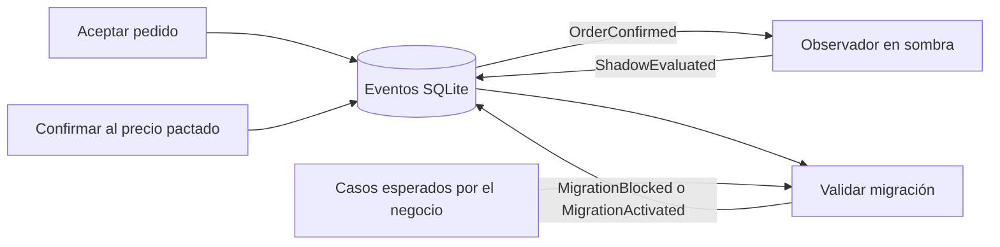

# Precio pactado
Una compra de $100 entra a las 23:55 con un cupón del 10 %. Cuando el cliente confirma a las 00:05, su precio ya está fijado en $90. Un candidato que evalúa la vigencia al confirmar propone $100. Esa diferencia bloquea su migración.

[Abrir la demo pública](https://precio-pactado-mariano-alvez.onrender.com/) · [Ver el comprobante de $90 y el bloqueo](docs/evidencia/migracion-bloqueada.png)

## Ejecutar localmente
Requiere Node 24.15 o superior de la rama 24 y npm. Desde la raíz:

```sh
npm ci
npm run build
npm start
```

Abrí [la demo local](http://127.0.0.1:4329). La API NestJS sirve el frontend Angular compilado. La base SQLite se crea en .var y queda excluida de Git. Reiniciar demo crea un recorrido independiente. El reinicio local conserva sesiones y precios mientras se mantenga el archivo de SQLite. `HOST`, `PORT` y `RULES_DB` configuran la interfaz de escucha, el puerto y la base.

La demo pública ejecuta la misma API y el mismo frontend en una instancia gratuita de Render. La primera visita después de un período sin tráfico puede tardar mientras arranca el servicio. El historial ficticio se conserva mientras Render mantenga el disco efímero de la instancia.

## Qué probar
1. Aceptá el pedido y confirmá a las 00:05. Compará el cobro y la propuesta en sombra del comprobante.
2. Intentá migrar y abrí **Matriz y pruebas**. El caso que cruza medianoche compara el resultado con el importe esperado por el negocio. Dos motores con el mismo defecto también fallarían esa prueba.
3. Reintentá la confirmación, corregí la matriz y validá para activar. El pedido siguiente sale $100 y el primero sigue en $90. En **Eventos** aparecen ambos pedidos y las dos observaciones del original.
4. En **Costos**, compará tarifa, volumen, guardia y ensayo de salida sobre un plazo de 36 meses. Los valores son supuestos editables.

## Decisión de arquitectura
El [registro de la decisión](docs/adr/001-precio-pactado-y-cambio-de-motor.md) documenta las alternativas, el costo del observador y las condiciones para revisar el diseño.


La [matriz versionada](api/src/domain/pricing.ts) elige la fila y el reloj de evaluación. El [agregado](api/src/domain/run.ts) acepta o rechaza comandos y produce hechos. El [registro durable](api/src/event-store.ts) permite recuperar el observador tras una caída. La política se comprueba contra importes y reglas fijados independientemente. Cobrar y observar son operaciones separadas. El registro conserva qué versión se aplicó a cada pedido y qué resultado propuso cada candidato.

El costo de evaluar en sombra es ejecutar dos cálculos y guardar observaciones. Durante la demora del consumidor, se puede confirmar al precio pactado y la migración espera la evidencia actualizada. Este laboratorio usa un solo proceso y SQLite. No llama a un proveedor externo ni mueve dinero.

## Verificar
```sh
npm test
npm run test:ui
npm run test:browser
npm run test:layout
```
Las pruebas de navegador usan el servidor local ya iniciado. Requieren Chromium de Playwright (`npx playwright install chromium`) o BROWSER_BIN apuntando a una instalación compatible. El recorrido de compra se prueba a 1440 y 390 px. La prueba de maquetación revisa las cuatro vistas en siete anchos entre 320 y 1440 px, mide la alineación del comparador y verifica los estados de edición. El caso de reinicio del servidor usa una base temporal aislada.

[Requisitos](docs/producto/01-prd.md) · [Diseño técnico](docs/producto/02-trd.md) · [Interfaz](docs/producto/03-diseno-ui-ux.md) · [Recorridos](docs/producto/04-appflow.md) · [Contratos](docs/producto/05-esquema-backend.md) · [Plan y pruebas](docs/producto/06-plan-implementacion.md)
